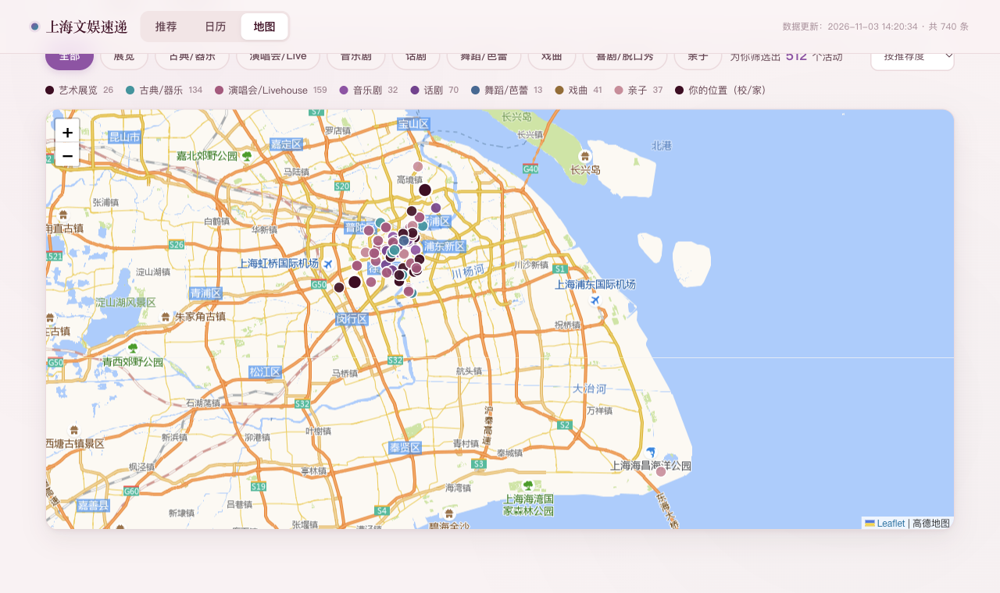
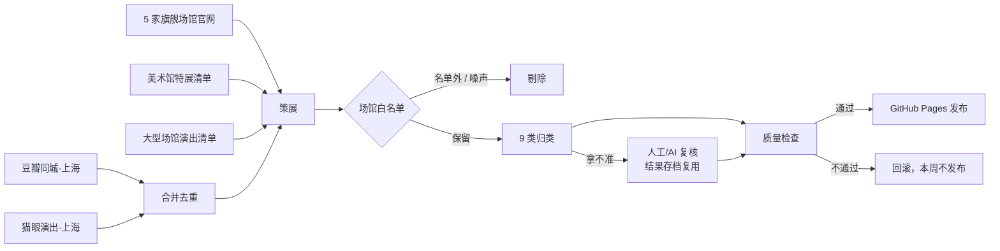

# 上海文娱速递

**上海正规场馆的演出与展览，一页看完，每周自动更新。**

👉 **在线访问：https://wondering-spec.github.io/shanghai-events/**


## 为什么做这个

想在上海找一场值得去的演出或展览，信息散在豆瓣同城、猫眼、大麦、各剧院官网和美术馆公众号里，而且：

- **小规模内容太多**：平台列表里混着大量商场快闪、DIY 画室、VR 乐园、烛光音乐会连锁、开放麦，真正想看的剧院演出被淹没。
- **分类不靠谱**：舞剧、芭蕾、京剧和越剧都被塞进「话剧/戏剧」，歌手演唱会被标成「古典音乐会」。
- **美术馆展览和大型演唱会缺失**：美术馆特展很多不在票务平台卖票；大型演唱会常常只在某一家平台独家开售。
- **不知道去一趟要多久**：同样一场演出，从学校去和从家里去，通勤时间差别很大。

这个网站把多个来源的信息合并、筛选、重新分类，只保留正规场馆的内容，并按「从哪出发、通勤多久」来排序推荐。

## 能做什么

- **按偏好推荐**：综合兴趣类别、通勤时间、档期和热度打分排序
- **两个出发点比较**：分别算从学校和从家出发的地铁通勤，取更近的那个；也可以输入任意地点
- **9 类筛选**：艺术展览、古典/器乐、演唱会/Livehouse、音乐剧、话剧、舞蹈/芭蕾、戏曲、喜剧/脱口秀、亲子
- **场馆分级**：旗舰/大型场馆，或专业中型剧场、美术馆和知名 Livehouse
- **日历和地图视图**，按价格上限、兴趣标签、关键词筛选
- **购票入口**：大麦/猫眼搜索、官方信息页、高德导航



## 数据怎么来的



| 环节 | 做法 |
|---|---|
| **平台数据** | 抓取豆瓣同城、猫眼上海站的演出/展览列表，合并跨平台的重复条目 |
| **场馆官网** | 上海大剧院、上交音乐厅、上音歌剧院、东方艺术中心、上海文化广场：补官方链接，提前收录平台还没上架的远期场次 |
| **策展清单** | 每周联网核实约 20 家美术馆/博物馆的特展，以及梅奔、东方体育中心等大场馆已官宣的演出，每条附来源链接 |
| **场馆白名单** | 99 家场馆，分「旗舰/大型」和「专业中型」两档；名单外的整体剔除，名单内的再按关键词剔除 DIY/VR/烛光/开放麦/课程等 |
| **分类** | 依据可信度从高到低：标题里的明确关键词 → 场馆类型 → 平台原分类；规则拿不准的进复核队列，结论存进 `data/labels.json`，以后不再重复判断 |
| **质量检查** | 条数下限、不允许骤降、不允许过期活动、不允许出现隐私信息；任何一项不通过就自动回滚 |
| **发布** | 每周一自动运行，通过检查后推送到 GitHub Pages |

### 一些取舍

- **不抓大麦和票星球**：两家都有验证码或限流，硬抓既不稳定也不合适。它们独家开售的大型演出，靠每周联网核实大型场馆的公开信息来补。
- **宁缺毋滥**：引入场馆白名单后，条目从约 1100 条减到约 740 条。减掉的大多是小剧场、商场快闪和体验类项目。
- **官网主要用来补漏**：接入 5 家旗舰场馆官网后发现，其中约 94% 的节目平台上已经有了。官网真正的价值是提供权威链接、更早收录远期场次。
- **不稳定的来源有兜底**：豆瓣抓取设 20 分钟上限，某家官网失败就沿用上次的数据。单个来源出问题只会让那一周少更新一部分，网站不会出错。

## 当前数据概况（2026-11-03）

| 类别 | 条数 | 类别 | 条数 |
|---|---|---|---|
| 古典/器乐 | 201 | 戏曲 | 51 |
| 演唱会/Livehouse | 189 | 舞蹈/芭蕾 | 41 |
| 话剧 | 93 | 音乐剧 | 39 |
| 亲子 | 64 | 艺术展览 | 37 |
| 喜剧/脱口秀 | 25 | **合计** | **740** |

其中 350 条在旗舰场馆，151 条附有官方信息链接。

## 项目结构

```
index.html              网站本体（单页，数据内嵌在 window.__EVENTS__）
posters/                海报（webp）
data/
  venues.json           场馆白名单 + 噪声规则
  labels.json           分类复核结论
  exhibitions.json      美术馆特展清单
  big_shows.json        大型场馆演出清单
  official_shows.json   场馆官网抓取结果
  review_queue.json     待复核条目
tools/update/
  update.sh             一键更新（13 步）
  weekly.sh             每周任务：更新 → 检查 → 提交推送
  curate.py             策展：白名单、归类、合并清单
  venue_crawl.py        场馆官网抓取
  db_*.py / maoyan_*.py 豆瓣、猫眼抓取与合并
  README.md             更新流程细节与踩过的坑
```

## 本地运行

```bash
# 预览网站
python3 -m http.server 8765
# 打开 http://127.0.0.1:8765/

# 完整更新一次数据（约 20–30 分钟）
bash tools/update/update.sh

# 只重跑策展（改了白名单或分类规则后）
python3 tools/update/curate.py --dry   # 先看统计，不写回
python3 tools/update/curate.py
```

依赖：Python 3，下载海报时还需要 Pillow。前端没有构建步骤，Leaflet 已内嵌在页面里。

## 说明

- 本站只做信息聚合和个人推荐，**演出时间、票价以官方和售票平台为准**。
- 活动信息与海报版权归各平台、场馆和主办方所有。
- 页面上的「学校」「家」是作者自己的通勤出发点，家的位置只精确到附近地铁站。
- 开发方式：在 AI 编程助手（WorkBuddy、Claude）的辅助下实现；需求、筛选规则和分类标准由作者设计并验收。
